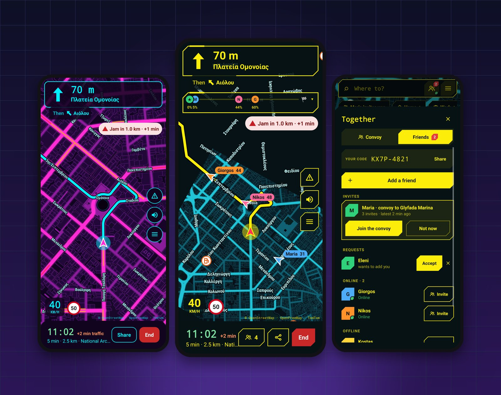
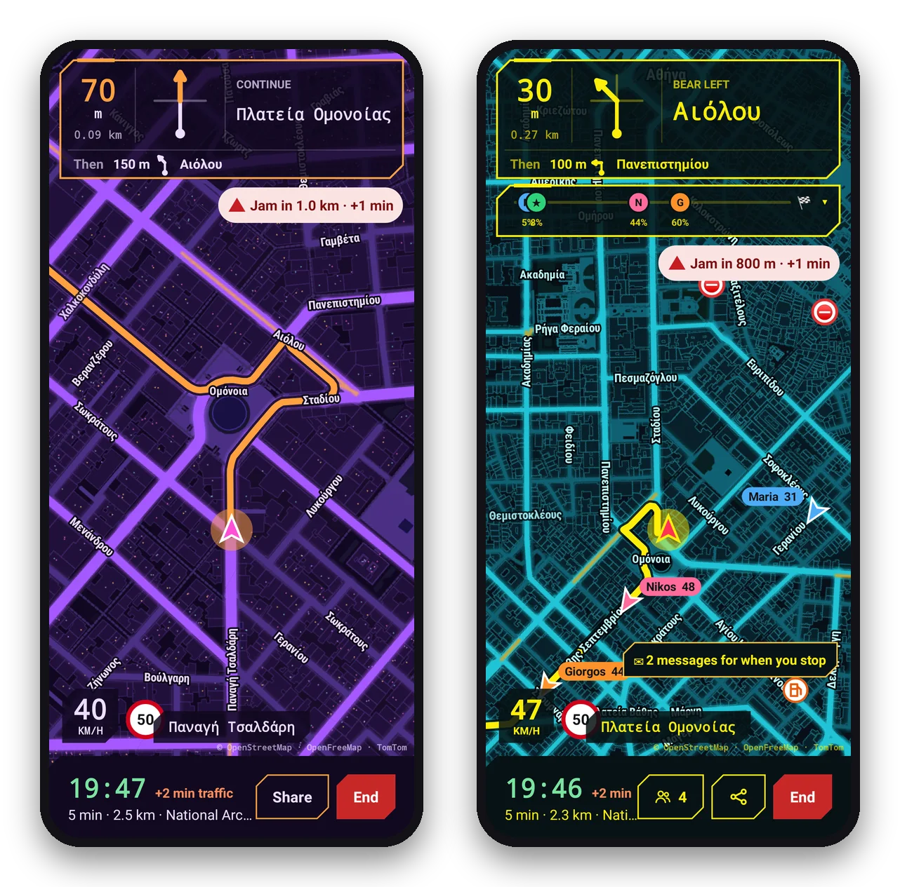
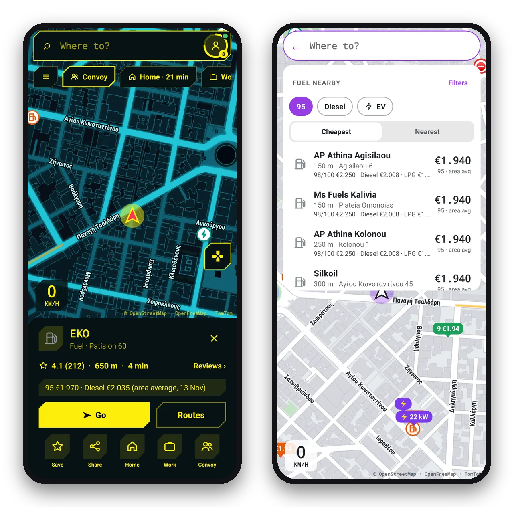
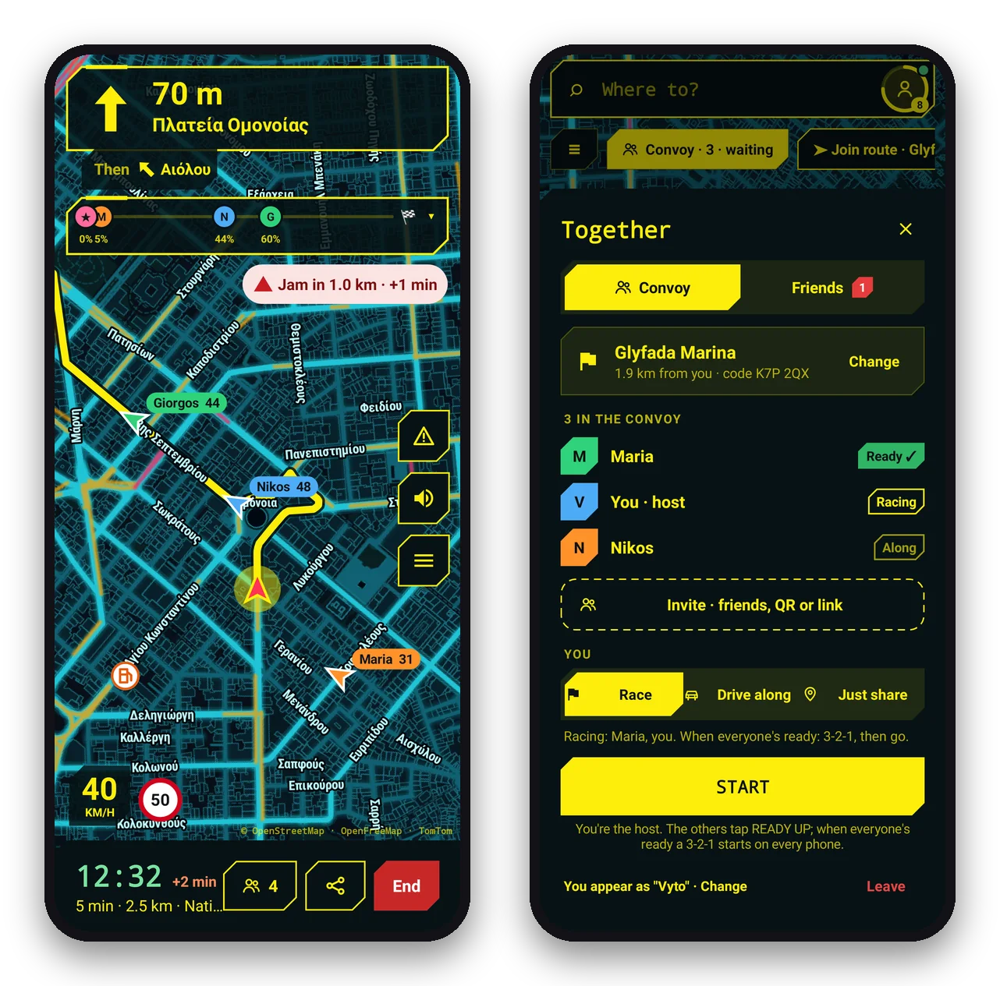
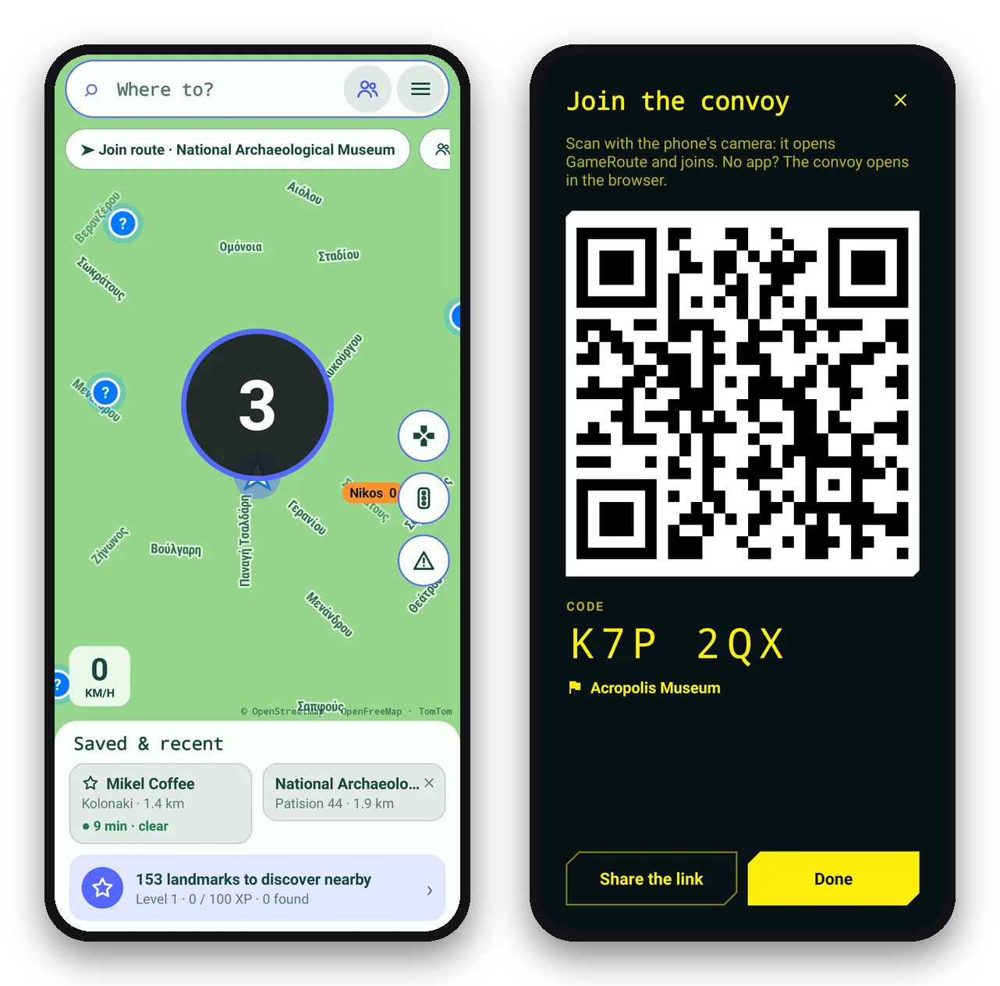
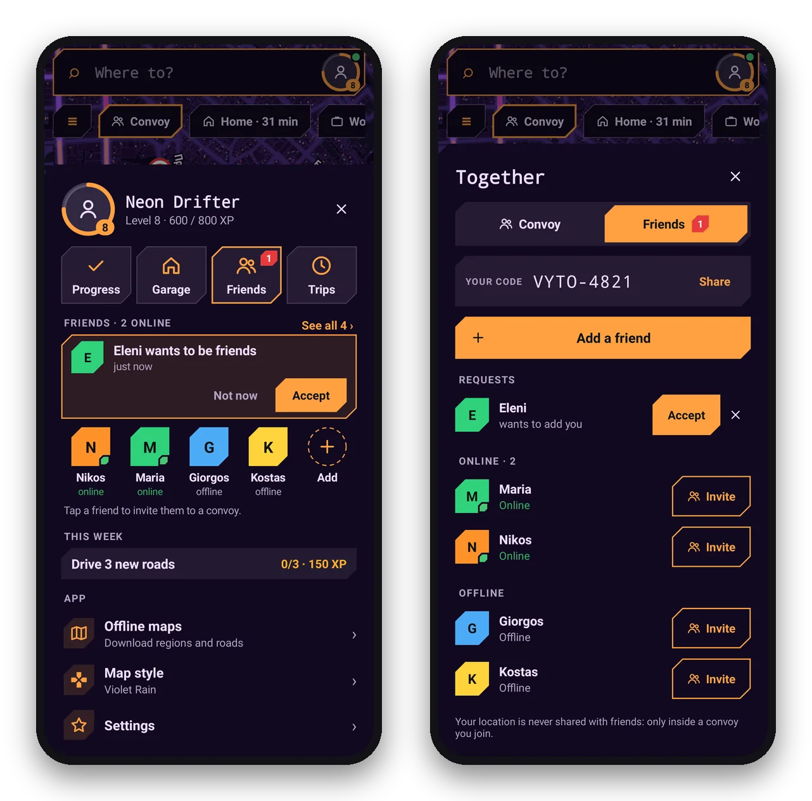
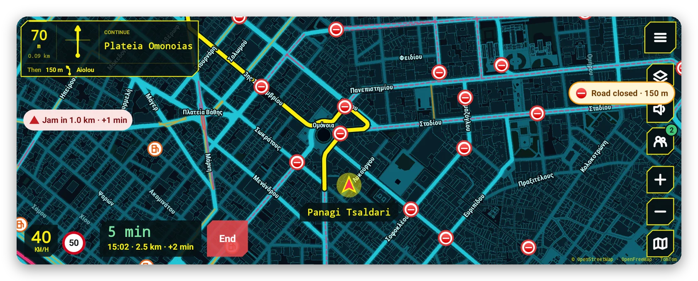
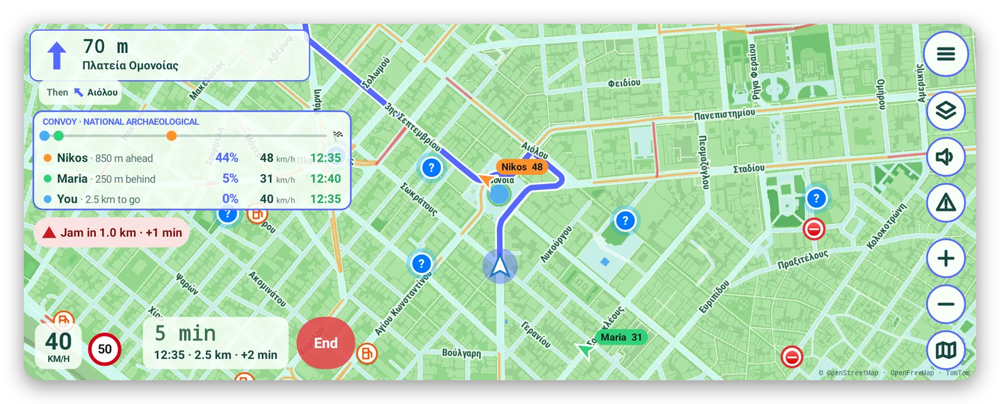
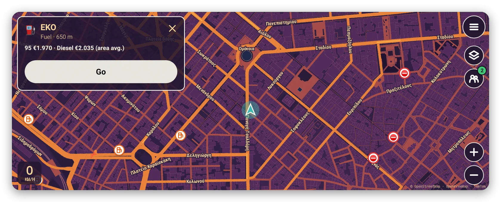

# GameRoute

**Navigation that looks like a video-game minimap.** 
For Android and Android Auto · English and Ελληνικά

 
<a href="../../releases/latest">All releases</a> · <a href="#-install">How to install</a> · Android 8+

## ✨ In short

- 🔎 **Search** in Greek, English or Greeklish: shops, towns, sights, addresses
- 🛣️ **Routes timed with live traffic**, tolls, and a new route within seconds
- 🧭 **Big turn card**, lanes, speed limit, cameras, spoken in English or Greek
- 👥 **Convoy:** drive together, see everyone live, start with a 3-2-1 race
- 🤝 **Friends:** invite them to a convoy in one tap
- ⛽ **Fuel by price**, places on the map, offline maps
- 🚘 **Android Auto**, with its own map style
- 🎨 **8 map styles** inspired by game genres

---

## 🔎 Find it, pick a route

**Find anything.** Shops, cafés, towns and sights from TomTom, OpenStreetMap and Overture Maps (nearly half a million places in Greece and Cyprus). "ναυπλιο" finds Nafplio, "σουνιο" the temple. Links from Google Maps, Waze or Viber open straight in GameRoute.

**Pick a route.** Up to three, each timed with live traffic, with where the jams are and the toll cost.

## 🧭 Drive

A big turn card with lanes, your speed next to the limit, and warnings for jams, cameras and tolls. Take another street and a new route comes within seconds. At the end: journey time, time saved and XP.

## 📍 Places and fuel

Fuel, parking, food and pharmacies on the map. Tap one to go, save it or give it a label ("Dad") for a one-tap shortcut. Fuel stations sorted by price for your fuel; chargers by plug.

## 👥 Convoy

**See everyone, live.** Each driver has a colour, arrow, name and speed, updated every second. The strip at the top shows how far along everyone is.

**Start together.** Share the code, a link or a QR code. Everyone presses *I'm ready* and a 3-2-1 countdown starts the routes on every phone and car. Anyone can suggest a destination; the others confirm it.

## 🤝 Friends

Add the people you drive with by code, link or QR, or straight from the convoy. See who's online and invite them in one tap; the invite reaches them even with the app closed, and you see when it's seen and accepted. **Your location is never shared with friends**, only inside a convoy you both join.

## 🚘 Android Auto

The same map on the car screen with see-through buttons, the convoy box, places to tap, and its own style. It turns dark with your headlights.

<b>More car screens</b>

 

## 🎨 Map styles

Each has a light and a dark version, or switches by itself at sunset. Zoom out for the whole continent, with country names in your language.

<b>Dark versions and the style list</b>

 

- **Free Roam:** asphalt-grey streets, a purple route
- **Might City:** teal megacity grid, yellow route
- **Midnight Run:** neon roads with a horizon glow
- **Blockworld:** a block world built from the real buildings
- **Realm Map:** old paper map, ink roads
- **Fire Tower:** dusk colours, purple to sunset orange
- **8-Bit:** handheld-console greens, pixel panels
- **Catch 'Em Trail:** bright outdoors, landmarks to collect (+25 XP each)

## 📲 Install

**Phone only:** download [GameRoute.apk](../../releases/latest/download/GameRoute.apk), open it and allow installing. Updates come inside the app (Settings ▸ App ▸ Check for updates).

**With Android Auto** (it only shows apps it thinks came from Google Play), install with **UnknownAuto**:

1. Android Auto settings ▸ tap **Version** 10 times ▸ ⋮ ▸ Developer settings ▸ **Unknown sources**: on.
2. Install **Shizuku** (Play Store) and **[UnknownAuto](https://github.com/GitMag/UnknownAuto)**.
3. Start Shizuku (Wireless debugging).
4. UnknownAuto ▸ Load `GameRoute.apk` ▸ **Install** ▸ allow Shizuku.
5. Open GameRoute once and allow location, then restart the phone and connect to the car.

Every build is signed with the same key, so new versions install over old ones.

## 🔒 Privacy

No account and no tracking: trips, places and settings stay on your phone. Convoy and friend messages are end-to-end encrypted before they leave it. [Privacy page](https://vyto-line.github.io/GameRoute/privacy/).

<b>Build and credits</b>

 

**Build:** Actions ▸ **Build APK** ▸ Run workflow; each build becomes a release with `GameRoute.apk`. Kotlin and the Android Car App Library, no Google Play services: map drawing, routing and search are done in the app. The pictures here are the app's own screens (`ReadmeShotsTest`, framed by `tools/readme_images.py`).

**Credits:** map data © [OpenStreetMap](https://www.openstreetmap.org/copyright) contributors · vector tiles by [OpenFreeMap](https://openfreemap.org) · places by [Overture Maps](https://overturemaps.org) · country names by [Natural Earth](https://www.naturalearthdata.com) · traffic, incidents, speed limits and search by [TomTom](https://developer.tomtom.com) · routing by [OSRM](https://project-osrm.org) · search by Photon and Nominatim · fuel prices by [fuel-prices.eu](https://www.fuel-prices.eu) · convoy and friends relays: ntfy.sh, EMQX and HiveMQ · QR codes by ZXing · optional star ratings by Google Places. These are free services: please keep use personal and moderate.

> ⚠️ Keep your eyes on the road. Set your destination before you drive, and follow local laws about speed camera alerts.
