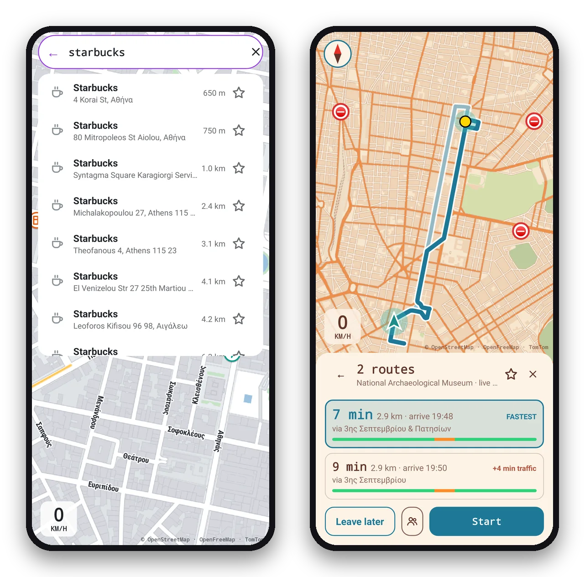
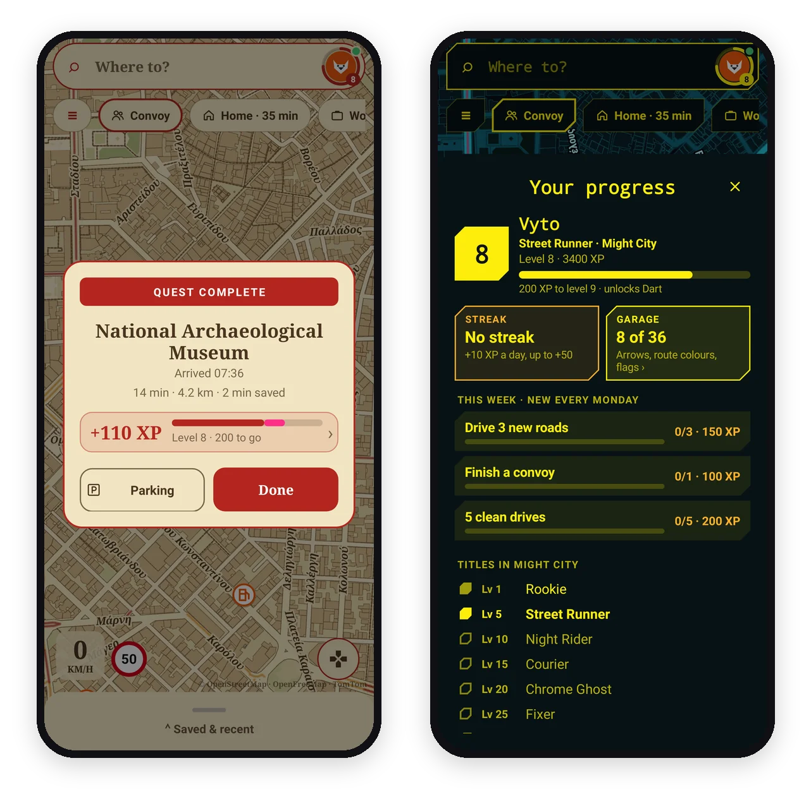
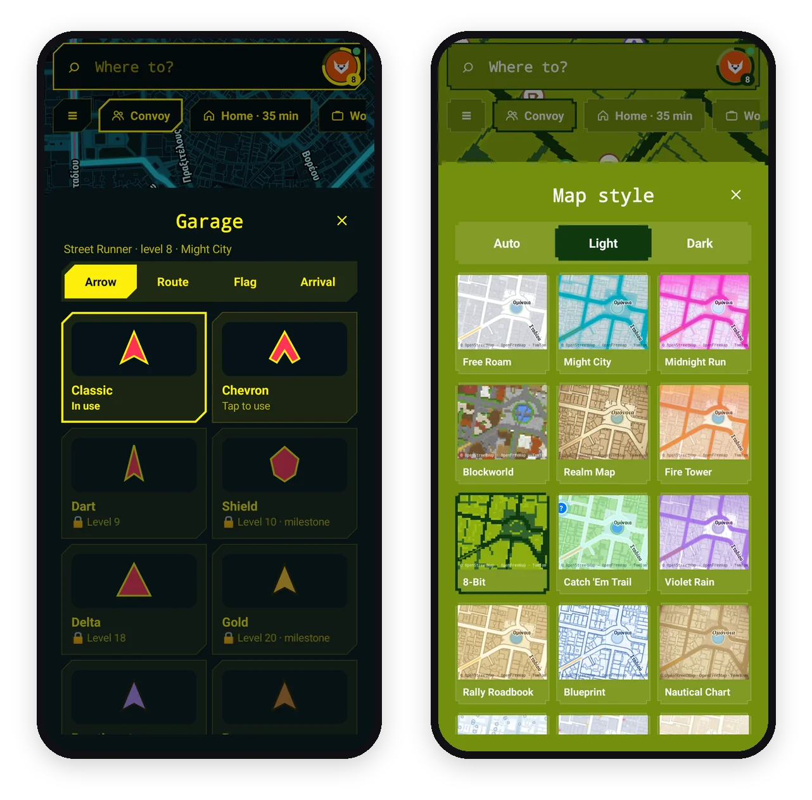
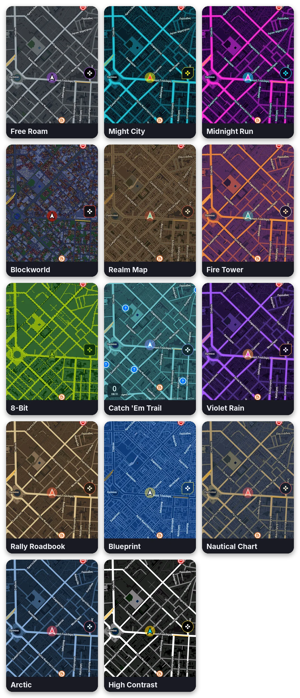
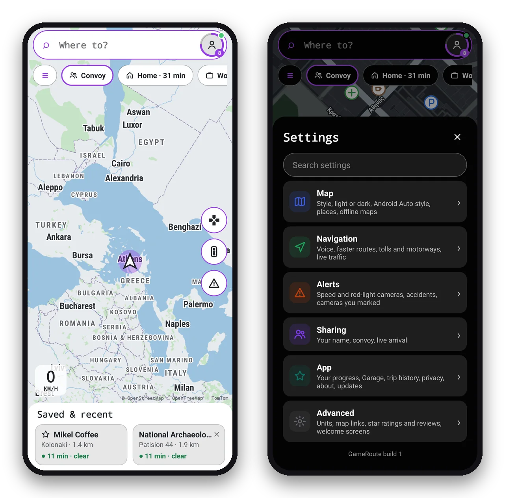

# GameRoute

**Navigation that looks like a video-game minimap.** 
Android · Android Auto · English and Ελληνικά

<a href="../../releases/latest">All releases</a> · <a href="#-install">How to install</a> · Android 8+ · free, no account

> [!TIP]
> **New in build 110:** a new route in a second or two when you take another street, an arrow that curves smoothly through turns, pop-ups in GameRoute's own look, 12 avatars your friends see, their own level celebrations for seven more styles, Friends drawn in the style on Android Auto (activity, invites, convoy actions), at most one faster-route message every 5 minutes, and a switch for the road name under the arrow.
>
> **Build 100** brought prestige ranks, a celebration every 5 levels, your monthly recap, the junction-sketch turn box, better GPS, your status (Online / Do not disturb / Invisible), friends and convoys in Android Auto, the Performance page, a home screen widget, and backup & restore.

## ✨ At a glance

- 🔎 **Search** in Greek, English or Greeklish
- 🛣️ **Live traffic** routes, tolls, new route in seconds
- 📴 **Works offline:** maps, places and routes with no signal
- 👥 **Convoy:** drive together, race with a 3-2-1
- 🤝 **Friends:** invite them in one tap
- 🏆 **XP, levels, prestige ranks** and a Garage of unlocks
- 🎨 **14 map styles**, each with day and night
- 🚘 **Android Auto**, with its own style

---

## 🔎 Find it

Shops, cafés, towns, sights and addresses. **"ναυπλιο"** finds Nafplio, **"σουνιο"** the temple, and you can paste coordinates or a Google Maps link.

Pick from up to **three routes**, each timed with live traffic, with the jams and the toll cost.

## 🧭 Drive

A **turn box like a rally roadbook**: the distance, a sketch of the junction with your way out marked, and the next turn underneath, in every style. The road you're on shows at the bottom.

- **Clear voice:** "In 200 metres, turn right", then "Turn right" at the right moment (1 km and 500 m on the motorway). Just the turn, no street names. Choose how much it talks
- **Street names your way:** in English, Greek street names show in Latin letters, like the road signs ("Aiolou", "Panagi Tsaldari")
- **Zooms with the road:** out on highways, in on small streets, with or without a route
- **Better GPS:** the arrow stays on the road, ignores jumps between tall buildings, and tells you when the signal is weak
- **Calm while moving:** the buttons fade; tap the map to bring them back
- **Nothing pops up at speed:** landmarks and friend news wait for when you stop
- **Tunnels** stay drawn, and **no signal** keeps the route going

## 📴 Offline

Download a region in **Settings ▸ Offline maps** and the map and places work with no data. Add **Roads of Greece** (about 78 MB) and new routes and reroutes are worked out on the phone, following turn restrictions.

## 👥 Convoy

**One tap away:** the Convoy chip sits right after ≡ and shows the convoy's live status.

**In the lobby,** everyone picks:
- 🏁 **Race:** the host taps **START**, everyone else **READY UP**, then 3-2-1
- 🚗 **Drive along:** same route, no race
- 📍 **Just share:** be on the map without driving

**Invite** with a QR code, a link, or your friends in one tap. Everyone's arrow, name and speed update every second, distances match on every phone, and the 3-2-1 starts at the same moment for all.

**Quick messages:** "Need fuel", "Stopping soon", "Go ahead", "Wait for me": one tap, read aloud to everyone driving.

## 🤝 You and your friends

**One button** for everything that's yours: your level, the Garage, friends, trips and settings. Friend requests and convoy invites wait on top.

**Your status:** Online, **Do not disturb** (invites wait quietly) or **Invisible** (you look offline), back to Online by itself when you choose.

**What friends are up to:** driving now, in a convoy, or when they were last online. Never where: Invisible friends show nothing.

**Your location is never shared with friends,** only inside a convoy you both join.

## 🏆 XP and the Garage

Earn XP for every trip, **new roads**, **clean drives**, convoys, a **daily streak** and **weekly challenges**. Race places only count after a clean drive: **no XP for speed.**

Levels unlock **arrows, route colours, destination flags and arrival effects**, and each style has its own titles, with a **celebration every 5 levels** in your style's look. At level 50, **prestige** to Bronze, Silver, Gold, Platinum and Diamond: more XP for good and rewards in each rank's colour. Your level stays private unless you choose to show it.

**Your recap:** your month or year on the road as a card to share (never Home or Work).

## 📍 Places and fuel

Fuel, parking and food on the map. Fuel sorted by price for your fuel; chargers by plug. Label a place ("Dad") for a one-tap chip.

## 🚘 Android Auto

The same map on the car screen, with the convoy box, places to tap, and its own style. It turns dark with your headlights.

- **Turns on the car's own display** behind the wheel and the head-up display, where the car supports it
- **Friends in the car:** see who's online and what they're doing, invite in one tap, start a convoy, READY UP in the lobby, send a quick message, drive to the convoy's destination, or leave the convoy
- **Choose your route on the car screen:** up to three routes, all on screen, and the choice stays in the car (your phone keeps its own map)

<b>More car screens</b>

 

## 🎨 14 map styles

Light, dark, or switching by itself at sunset.

<b>Night versions and the list</b>

 

- **Free Roam:** asphalt grey, purple route
- **Might City:** teal megacity, yellow route
- **Midnight Run:** neon roads, horizon glow
- **Blockworld:** built from the real buildings
- **Realm Map:** old paper map
- **Fire Tower:** dusk colours
- **8-Bit:** handheld-console greens
- **Catch 'Em Trail:** landmarks to collect
- **Violet Rain:** purple neon, amber route, rain
- **Rally Roadbook:** sand and dust
- **Blueprint:** drafting lines, highlighter route
- **Nautical Chart:** a sea chart
- **Arctic:** bright ice, red route
- **High Contrast:** black and yellow, easy to read

---

## ⚡ Performance and your data

**Settings ▸ Performance:** Auto, Smooth or Battery; map effects, animations and smoothness your way. The map draws about a third faster than before, keeps finished map squares on the phone, and rests the GPS at red lights.

**Backup & restore** keeps your level, prestige, Garage, trips, places and friends in one file when you change phones. A **home screen widget** shows Home and Work with the drive time.

## 📲 Install

**Phone only:** download [GameRoute.apk](../../releases/latest/download/GameRoute.apk), open it and allow installing. Updates come inside the app.

<b>With Android Auto</b>

 

Android Auto only shows apps it thinks came from Google Play, so install with **UnknownAuto**:

1. Android Auto settings ▸ tap **Version** 10 times ▸ ⋮ ▸ Developer settings ▸ **Unknown sources**: on.
2. Install **Shizuku** (Play Store) and **[UnknownAuto](https://github.com/GitMag/UnknownAuto)**.
3. Start Shizuku (Wireless debugging).
4. UnknownAuto ▸ Load `GameRoute.apk` ▸ **Install** ▸ allow Shizuku.
5. Open GameRoute once and allow location, then restart the phone and connect to the car.

Every build is signed with the same key, so new versions install over old ones.

## 🔒 Privacy

No account, no tracking. Trips, places, XP and settings stay on your phone. Convoy and friend messages are end-to-end encrypted. [Privacy page](https://vyto-line.github.io/GameRoute/privacy/)

<b>Build and credits</b>

 

**Build:** Actions ▸ **Build APK** ▸ Run workflow; each build becomes a release with `GameRoute.apk`. Kotlin and the Android Car App Library, no Google Play services: map drawing, routing and search happen in the app. The pictures here are the app's own screens (`ReadmeShotsTest`, framed by `tools/readme_images.py`).

**Credits:** map data © [OpenStreetMap](https://www.openstreetmap.org/copyright) contributors · vector tiles by [OpenFreeMap](https://openfreemap.org) · places by [Overture Maps](https://overturemaps.org) · country names by [Natural Earth](https://www.naturalearthdata.com) · traffic, incidents, speed limits and search by [TomTom](https://developer.tomtom.com) · routing by [OSRM](https://project-osrm.org) · offline roads from [Geofabrik](https://download.geofabrik.de) extracts · search by Photon and Nominatim · fuel prices by [fuel-prices.eu](https://www.fuel-prices.eu) · convoy and friends relays: ntfy.sh, EMQX and HiveMQ · QR codes by ZXing · optional star ratings by Google Places. These are free services: please keep use personal and moderate.

> [!WARNING]
> Keep your eyes on the road. Set your destination before you drive, and follow local laws about speed camera alerts.
